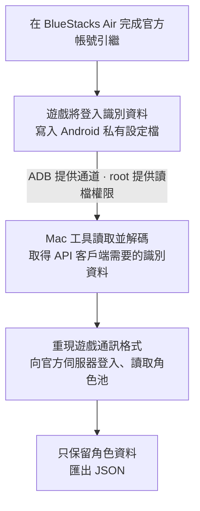

<div align="center">

# pcr-tw-roster-exporter

### 在 Mac 上匯出你的公主連結角色池

**在 Apple Silicon Mac 上，透過 BlueStacks Air 取得台版公主連結登入資料，並匯出自己的角色池 JSON。**

把角色、星數、等級、Rank 與專武資料整理成可處理的格式，<br>
用於個人紀錄、配隊研究，或交給 AI 分析培養方向。


**[如何運作](#如何運作)** · **[開始使用](#開始使用)** · **[輸出格式](#輸出格式)** · **[已驗證環境](#已驗證環境)** · **[技術文件](#技術文件)**

</div>

---

## 這個專案做什麼

這是一個台版《超異域公主連結☆Re:Dive》的角色資料匯出實驗紀錄。私人原型已完成匯出；此公開 repo 分享方法、證據摘要與合成資料範例。

本次實測成功讀取 **90 位角色**，包含角色 ID、星數、等級、Rank 與專武原始欄位。角色資料由官方伺服器回傳，再經白名單挑選匯出，不將登入憑證混入 JSON。

最關鍵的發現是：**在 Apple Silicon Mac 上，先以原始 BlueStacks Air 環境完成台版引繼，再切換 root 環境讀取登入資料，即可由 Mac 客戶端匯出角色池，不必先完成 12.59 GB 的追加素材下載。**

適合想了解資料取得流程、已有 Mac 環境，並希望手動匯出自己角色資料的玩家或開發者。

> [!NOTE]
> 此 repo 目前分享實驗文件與合成範例，不提供可執行匯出器。私人原型已在一組環境與一個帳號上成功。角色名稱尚未補入，專武顯示等級仍待交叉驗證；尚未整理成跨機器的一鍵安裝工具。

## 如何運作



**ADB 是通道，root 是本次讀取私有檔案的權限來源。** 它們不會直接授予官方伺服器的登入權限。真正讓客戶端能與伺服器互動的是解碼後的登入識別資料，以及正確的遊戲通訊格式。

| 元件 | 在流程中的責任 |
| :--- | :--- |
| 官方台版遊戲 | 完成正常帳號引繼，產生並保存本機登入資料 |
| BlueStacks Air | 在 Mac 上提供 Android 執行環境與遊戲資料儲存空間 |
| ADB＋Shell root | 讓 Mac 能讀取受 Android 沙盒保護的指定設定檔 |
| Mac Python 客戶端 | 解碼識別資料、組合 API 請求、讀取並匯出角色池 |

### 為什麼要切換映像？

本次 root 映像下遊戲出現黑屏；還原原始映像後可以正常進入遊戲。因此把流程拆成兩段：

1. **原始映像負責官方引繼。** 完成後取消追加素材下載並關閉 Air。
2. **root 映像負責讀檔。** 使用同一份 Android 使用者資料，不開遊戲，由 Mac 客戶端直接呼叫 API。

切換的是啟動映像，不是清空遊戲資料。精確黑屏原因尚未證明；這是本次有效的操作方法，不代表所有 root 環境都會黑屏。

## 我們取得了什麼

讀到的是遊戲自己的登入識別資料，不是角色池，也不是 Apple／Facebook 密碼。

| 欄位 | 高階理解 |
| :--- | :--- |
| `UDID` | 遊戲使用的裝置／安裝識別資料；不是 iPhone 硬體 UDID |
| `SHORT_UDID` | 另一個遊戲識別值，客戶端會轉成請求標頭 |
| `VIEWER_ID` | 玩家識別值，需要按照儲存格式正確還原 |
| `TW_SERVER_ID` | 台版伺服器相關識別值，用來協助組合與檢查 |

這組資料加上正確協定，在本次實測中足以完成登入。單獨知道公開玩家 ID，並不等於具備同樣的登入能力。

> [!IMPORTANT]
> 上述值應視為敏感的登入相關資料。不要將 PlayerPrefs、識別值、完整 API 回應或請求標頭提交到 GitHub。工具只在記憶體處理必要憑證，角色 JSON 不包含這些值。

<details>
<summary><strong>展開：設定檔位置與 ID 組合細節</strong></summary>

本次有效來源：

```text
/data/data/tw.sonet.princessconnect/shared_prefs/tw.sonet.princessconnect.v2.playerprefs.xml
```

欄位依公開 helper 的邏輯解碼。UDID 正規化為32個十六進位字元；SHORT_UDID使用十進位字串。VIEWER_ID與server依上游公式組合：

```python
full_viewer_id = (server_id << 30) | viewer_low_bits
```

本次帳號的lowBits已含完整ID相關位元，因此另比對儲存的高低位組合，確認合成值一致後才繼續，沒有任意截斷或mask。這也修正了早期離線檢查「lowBits必須小於30位」的保守假設。

helper搜尋的22位純數字token候選，不是這條台版TWClient登入路徑的必要輸入。

</details>

## 開始使用

**目前公開內容是方法與實驗文件，不包含登入／解碼工具。** 三個核心上游在本次固定commit沒有查到授權聲明，因此暫不重新散布上游原碼或依其改寫的原型。詳見[上游授權與檔案判定](docs/licensing.md)。

1. 先讀[方法與實驗結果](docs/experiment.md)，了解原始映像／root映像分工。
2. 讀[泳道圖與函數說明](docs/architecture.md)，了解已成功的私人原型如何運作。
3. 查看[合成角色JSON](examples/roster.synthetic.json)，評估資料格式是否適合自己的用途。

這個 repo 沒有提供可直接登入的安裝指令，不需要在閱讀文件時開啟ADB或root。實驗本身使用了官方台版遊戲、BlueStacks Air、ADB與Python，但不把它們的安裝器、遊戲包或映像放進此repo。

可在本機檢查公開候選內容：

```sh
python3 tools/check_public_tree.py
```

此檢查只驗證檔案清單、文件連結與常見敏感資料樣式，不讀取裝置、不連網。它不是完整秘密偵測或法律審查。

## 輸出格式

以下為**合成範例**，不是玩家實際資料，也不代表任何特定角色的真實狀態：

```json
{
  "schema_version": 1,
  "region": "TW",
  "exported_at": null,
  "source_app_version": "5.9.0",
  "units": [
    {
      "id": 100101,
      "name": null,
      "unit_rarity": 3,
      "battle_rarity": 3,
      "unit_level": 100,
      "promotion_level": 15,
      "exceed_stage": 0,
      "unique_equip_slot": []
    }
  ],
  "verification": {
    "live_api_tested": false,
    "synthetic_example": true,
    "name_mapping": "not_added",
    "unique_equip_display_semantics": "raw_fields_only"
  }
}
```

`synthetic_example: true` 與 `live_api_tested: false` 明確標示這是合成範例；真實匯出的成功摘要已另外去識別化記錄。

| 需求 | JSON欄位 | 說明 |
| :--- | :--- | :--- |
| 角色 | `id` | 保留角色ID；`name`目前為null |
| 星數 | `unit_rarity`、`battle_rarity` | 分別保留持有星數與戰鬥選用星數 |
| 等級 | `unit_level` | 伺服器回傳值 |
| Rank | `promotion_level` | 伺服器回傳值 |
| 專武 | `unique_equip_slot` | 保留各slot原始欄位，不只第一個slot |

專武slot包含 `id`、`is_slot`、`enhancement_level`、`enhancement_pt`、`rank`、`status`；未回傳的欄位保留null。slot數量不等於已裝備專武數量，顯示等級仍需交叉驗證。

## 已驗證環境

| 項目 | 本次實測 |
| :--- | :--- |
| Mac | Apple Silicon，測試設備為M2 |
| macOS | 27.0.1 |
| BlueStacks Air | 5.21.790.7505 |
| Android | 13，arm64-v8a |
| 台版遊戲 | 5.9.0，versionCode 113 |
| 套件 | `tw.sonet.princessconnect` |
| API版本標頭 | `APP-VER: 5.9.0` |
| TLS憑證驗證 | 開啟 |
| 結果 | 三個請求均HTTP 200、result_code=1；匯出90位角色 |

**這是特定版本與帳號的成功紀錄，不是所有Apple Silicon機型、台服路由或後續遊戲版本的相容性承諾。**

目前仍有以下限制：

- 憑證有效期限、跨裝置登入及未來版本相容性尚未完整驗證。
- 路由沿用上游規則，並加入本機一致性檢查；不能據此推論所有台服都適用。
- 角色名稱對照、專武顯示語義尚未完成。
- 私人原型已將ADB路徑改為環境設定，但版本與路由仍有限制；沒有宣稱跨機器即用。

## 技術文件

| 文件 | 內容 |
| :--- | :--- |
| [方法與實驗結果](docs/experiment.md) | 原始／root映像切換、成功證據與版本邊界 |
| [泳道圖與函數說明](docs/architecture.md) | 私人原型的引繼、取檔、封包與匯出資料流 |
| [上游授權與檔案判定](docs/licensing.md) | 固定commit、查核範圍、可放與暫不放的內容 |
| [程式來源分析](docs/code-provenance.md) | 逐函數來源對照、自寫部分與上游依賴 |
| [公開範圍](docs/publication.md) | 私人資料隔離、版本庫狀態與後續條件 |

## 參考與致謝

本專案參考下列公開原始碼專案，將本機取值、協定處理與角色匯出整理成獨立實驗流程：

- [SonderXiaoming/pcr_login_helper](https://github.com/SonderXiaoming/pcr_login_helper)：PlayerPrefs欄位解碼與ID組合。
- [SonderXiaoming/kanna_connection_redive_2](https://github.com/SonderXiaoming/kanna_connection_redive_2)：台版TWClient、請求協定與角色資料模型。
- [hanreev/root-bluestacks-air](https://github.com/hanreev/root-bluestacks-air)：BlueStacks Air啟動映像的root方法。
- [yetone/magpie](https://github.com/yetone/magpie)：README開頭的排版參考。

此為非官方實驗專案，與遊戲開發商、營運商及BlueStacks無隸屬關係。核心上游尚未查到明確授權；本 repo 不包含它們的原碼／改寫客戶端，也未宣告MIT或其他未經選定的授權。詳見授權查核文件。
