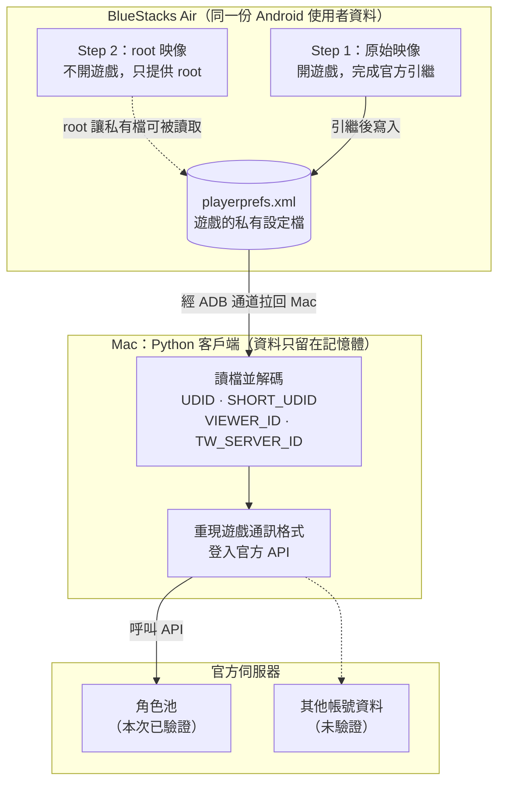
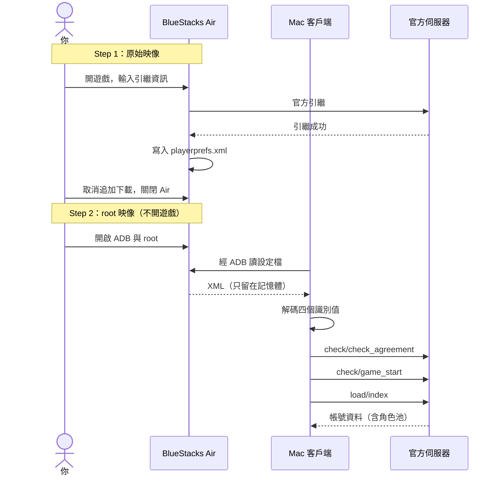

<div align="center">

# pcr-tw-mac-login

### 在 Mac 上取得台版公主連結的登入資料

**在 Apple Silicon Mac 上，透過 BlueStacks Air 取出台版《超異域公主連結☆Re:Dive》的登入資料，並用它從 Mac 登入官方 API。**

登入之後要做什麼由你決定：本次實測用來匯出自己的角色池，也可以延伸做其他研究。


[](LICENSE)

**[運作原理](#運作原理)** · **[完整流程](#完整流程)** · **[實測環境](#實測環境)** · **[致謝](#致謝)**

</div>

---

> [!NOTE]
> 這個 repo 只分享方法與實驗文件，不附登入／解碼工具。核心上游專案尚未查到授權聲明，因此暫不散布依其改寫的程式碼，詳見[上游授權與檔案判定](docs/licensing.md)。

## 運作原理



對照上圖：

- **為什麼要切換映像**：此環境在 root 映像下開遊戲會黑屏，所以讓原始映像負責引繼、root 映像只負責讀檔。兩者共用同一份使用者資料，也不必先下載 12.59 GB 的追加素材。
- **登入資料是什麼**：從 `playerprefs.xml` 解碼出的四個遊戲識別值，不是 Apple／Facebook 帳密。**但拿到它就能登入這個帳號，不要提交到 GitHub，也不要交給任何人。**
- **它能做什麼**：Mac 客戶端用它登入後，就能呼叫遊戲 API。本次讀取了 90 位角色；其他 API 可走同一個登入流程，尚未驗證。

<details>
<summary><strong>四個欄位各是什麼</strong></summary>

| 欄位 | 是什麼 | 登入時怎麼用 |
| :--- | :--- | :--- |
| `UDID` | 遊戲自己產生的安裝識別碼（不是 iPhone 硬體 UDID） | 請求加密 IV 與 PARAM 簽章的材料 |
| `SHORT_UDID` | 較短的安裝識別值 | 編碼後放進 `SHORT-UDID` 請求標頭 |
| `VIEWER_ID` | 玩家帳號的內部 ID | 與伺服器編號合成完整玩家 ID |
| `TW_SERVER_ID` | 帳號所在的台服編號 | 參與合成完整玩家 ID；連線主機由合成後 ID 的首字元決定 |

設定檔位置、解碼與 ID 合成細節見[系統泳道圖與函數解釋](docs/architecture.md)。

</details>

<details>
<summary><strong>應用範例：角色池匯出格式</strong></summary>

只保留角色資料，不把登入資料寫進 JSON。以下為合成範例，不是真實玩家資料：

```json
{
  "schema_version": 1,
  "region": "TW",
  "units": [
    {
      "id": 100101,
      "name": null,
      "unit_rarity": 3,
      "battle_rarity": 3,
      "unit_level": 100,
      "promotion_level": 15,
      "unique_equip_slot": []
    }
  ]
}
```

| 需求 | 欄位 | 說明 |
| :--- | :--- | :--- |
| 角色 | `id` | 角色 ID；`name` 尚未對照 |
| 星數 | `unit_rarity`、`battle_rarity` | 持有星數與戰鬥選用星數 |
| 等級 | `unit_level` | 伺服器回傳值 |
| Rank | `promotion_level` | 伺服器回傳值 |
| 專武 | `unique_equip_slot` | 保留各 slot 原始欄位，顯示等級仍待交叉驗證 |

完整範例見[合成角色 JSON](examples/roster.synthetic.json)。

</details>

## 完整流程

運作原理講資料怎麼流，這張泳道圖依時間順序列出每一步。



每個函數如何分工、封包怎麼組成，見[系統泳道圖與函數解釋](docs/architecture.md)。

## 實測環境

| 項目 | 本次實測 |
| :--- | :--- |
| Mac | Apple Silicon（M2） |
| macOS | 27.0.1 |
| BlueStacks Air | 5.21.790.7505 |
| Android | 13，arm64-v8a |
| 台版遊戲 | 5.9.0（versionCode 113） |
| 結果 | 三個 API 請求皆 HTTP 200、result_code=1 |

這是單一環境、單一帳號的成功紀錄，版本邊界與未驗證項目見[方法與實驗結果](docs/experiment.md)。

## 致謝

<div align="center">

這個實驗建立在以下開源專案之上

**[pcr_login_helper](https://github.com/SonderXiaoming/pcr_login_helper)** · SonderXiaoming<br/>
PlayerPrefs 欄位解碼與 ID 組合

**[kanna_connection_redive_2](https://github.com/SonderXiaoming/kanna_connection_redive_2)** · SonderXiaoming<br/>
台版客戶端與通訊協定

**[root-bluestacks-air](https://github.com/hanreev/root-bluestacks-air)** · hanreev<br/>
BlueStacks Air 的 root 映像

</div>

---

<sub>實驗與審查紀錄：[方法與實驗結果](docs/experiment.md) · [上游授權與檔案判定](docs/licensing.md) · [程式來源分析](docs/code-provenance.md) · [公開範圍](docs/publication.md)</sub><br/>
<sub>本 repo 的文件、圖表、合成範例與檢查腳本以 [Apache License 2.0](LICENSE) 授權；不涵蓋上游專案的程式碼。</sub><br/>
<sub>非官方實驗專案，與遊戲開發商、營運商及 BlueStacks 無隸屬關係。</sub>
