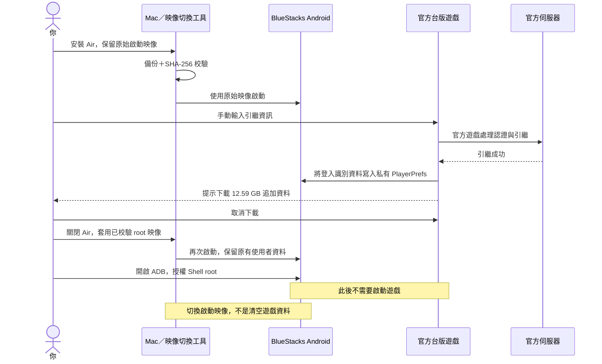
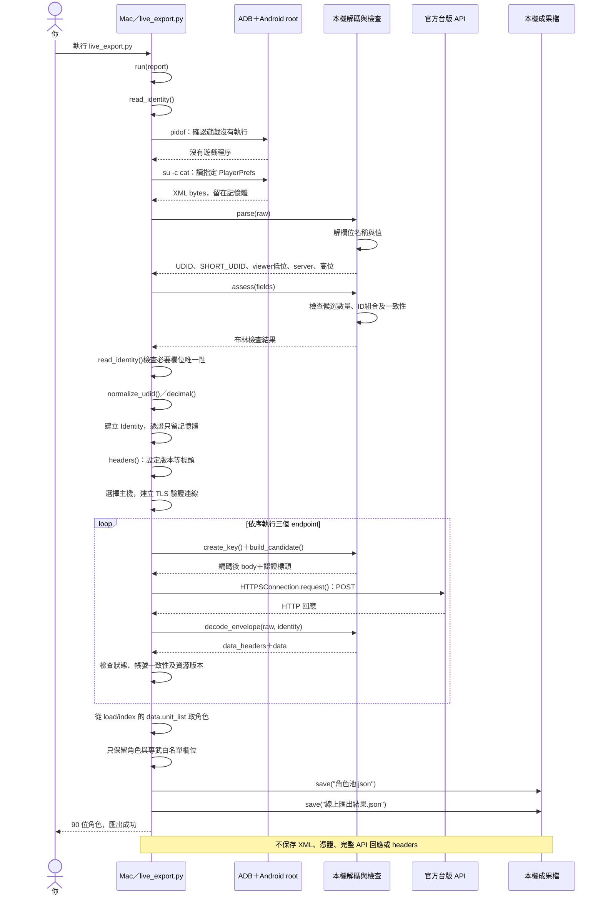
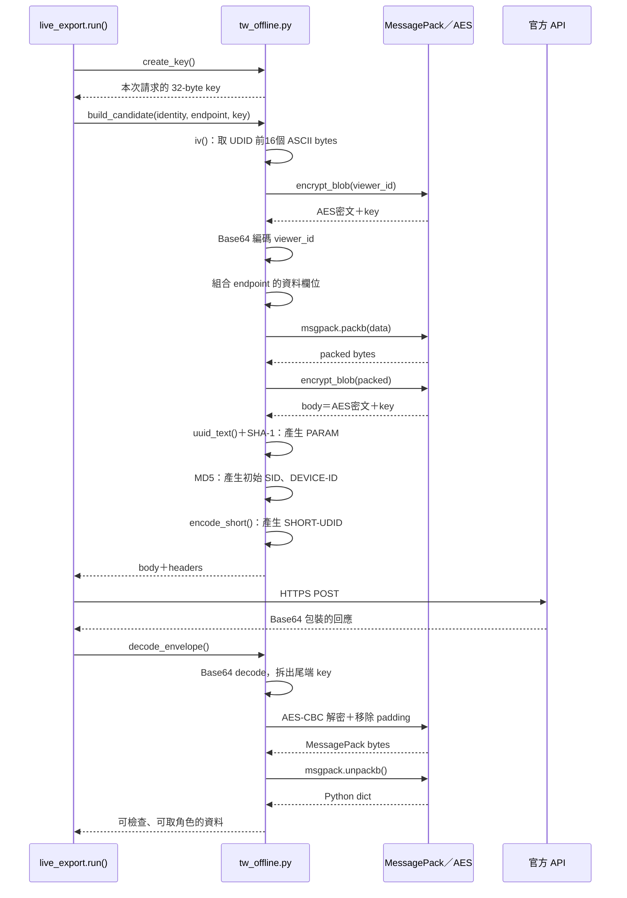

> 文件中的函數名用來說明私人原型，不表示此repo附有可執行客戶端。

# 系統泳道圖與函數解釋

歷史紀錄日期：2026-10-18；新版流程補充：2026-10-19。下方第 1～6 節保留首次成功匯出的原型紀錄，其中每次經 ADB 取憑證的流程已由新版分工取代，不應當成現行日常查詢入口。圖使用 Mermaid 語法，可在支援 Mermaid 的 Markdown 閱讀器中呈現。

**核心邏輯：Android 提供登入資料來源，真正查詢角色池的是 Mac 上的 Python 客戶端。** 遊戲美術、語音等完整素材不參與這段 API 查詢，因此不必先完成12.59 GB追加下載。

以下拆成三張泳道式時序圖。每條直線代表一個操作對象，箭頭代表跨對象傳遞的指令或資料。這是已實作流程的說明，不是新增執行指令。

## 目前分工：匯入一次，日常從鑰匙圈讀取

新版將 Android 私有檔案存取與伺服器查詢拆成兩個入口：

| 階段 | 資料來源與責任 | 驗證狀態（2026-10-19） |
|---|---|---|
| 憑證匯入 | 透過 ADB 與暫時 root 讀指定設定，在記憶體解碼、檢查，再將必要欄位寫入 macOS 鑰匙圈 | 實際匯入及讀回核對成功 |
| 日常 `read_identity()` | 只讀鑰匙圈並驗證必要欄位，不呼叫 ADB、不自行 root | 假資料跨程序與實際憑證讀取皆通過 |
| 日常查詢 | 以已讀取的憑證登入 API，驗證回應後保存白名單快照 | BlueStacks 關閉、ADB 停止時，四個端點成功 |

鑰匙圈保存 UDID、SHORT_UDID、VIEWER_ID 與 TW_SERVER_ID 所需的認證資訊；本文件只列欄位種類，不包含值。完整 PlayerPrefs 不存入鑰匙圈，也不作檔案副本。

鑰匙圈假資料建立、讀取、更新、刪除預檢已通過；兩個獨立 Python 程序在禁止 ADB 與網路的測試條件下，透過日常憑證讀取路徑成功取得假資料，測試項目之後已刪除。另有 30 項離線測試通過。預檢本身只證明鑰匙圈存取路徑可用；之後另以實際憑證完成獨立 API 查詢，詳見[實驗紀錄](experiment.md)。成功仍不保證更換執行環境或鑰匙圈鎖定後無需處理存取權限。

使用原生 macOS Security API 寫入及讀取，憑證不經命令列參數或環境變數傳遞。鑰匙圈保存的是具有登入能力的資料；目前客戶端限制查詢端點，不代表伺服器發給它唯讀權限。

鑰匙圈是持久儲存的例外；原始設定、解碼過程、請求與完整回應仍只在程序記憶體使用，成果檔僅保存白名單帳號資料。新版不自動退回 ADB 讀取，失敗即停止回報。憑證可能因引繼或其他帳號狀態變動失效；重新匯入需要另行執行首次設定流程。

環境分離不會改變伺服器的 session 規則。即使 BlueStacks 完全關閉，查詢仍可能影響手機或其他裝置登入。新版流程圖見 [README](../README.md#運作原理)。

---

以下為 2026-10-18 原型的歷史實作說明，保留當時證據與函數定義。

## 1. 準備階段：為什麼切換原始／root 映像



同一份遊戲資料留在 Android 裡，改變的是 Android 開機後是否能提供 root。本次 root 映像下遊戲曾黑屏，因此使用原始映像完成官方引繼，再切 root 讀檔，把「遊戲正常運作」和「讀取私有檔案」分成兩個階段。

官方遊戲內部如何交換引繼憑證，我們沒有逆向到函數層。圖中官方遊戲這一段表示操作與觀察結果；已證明取消追加下載後能讀到欄位，不代表精確掌握它在官方內部哪個函數、哪個瞬間落盤。

ADB 是 Mac 到 Android 的除錯通道，本身不等於 root。普通 shell 讀遊戲私有檔案會被沙盒權限阻擋；Shell root 才提供本次需要的讀取能力。

## 2. 匯出階段：我們實際寫的函數如何分工

以下是 `live_export.py` 的實際流程。



三個 endpoint 的順序：

```text
check/check_agreement
          ↓
check/game_start
          ↓
load/index
          ↓
data.unit_list
```

前兩個是上游台版客戶端採用的登入／初始化流程，第三個回傳帳號初始化資料，其中包含角色池。**角色資料由伺服器回傳，不是從手機存檔拼出來。**

目前程式以完整 viewer ID 的十進位首字元選擇上游主機，並在讀值時驗證它與解出的 server 一致。本帳號這次成功，不代表已證明所有台服路由皆適用同一規則。

三個請求均成功：HTTP 200、result_code=1。程式若遇到 HTTP、解碼、伺服器結果、帳號一致性或角色列表錯誤就停止，沒有自動換服或盲目重試。登入與初始化可能更新 session，不能當作伺服器絕對零副作用的操作。

## 3. 封包細節：憑證怎麼變成請求



### 這些技術各自做什麼

- **MessagePack**：把 Python 資料結構轉成二進位資料；用途類似 JSON，但格式不同。
- **AES-CBC 與 padding**：依遊戲協定包裝資料，讓內容符合區塊加密所需長度。
- **Base64**：二進位轉文字表示，不是加密。
- **PARAM**：依 UDID、endpoint、packed資料與viewer ID計算SHA-1，必須與送出的內容相符。
- **SID**：此實作依viewer ID、UUID與固定字串計算的初始識別標頭；不要與每次請求的AES key混用。
- **SHORT-UDID**：由short_udid產生協定要求的混淆字串，並非把原始十進位字串直接當標頭。

`create_key()`產生的是每次請求的加密key，不是帳號登入憑證；帳號識別資料來自PlayerPrefs。

上游協定把key附在封包尾端，因此AES包裝不能視為獨立的傳輸保密保障；實際網路傳輸仍依賴HTTPS與TLS憑證驗證。封包、headers與Base64內容也不能隨意當作無敏感資訊的除錯紀錄。

請求body是原始密文加key；回應則先有Base64外層，兩者不是完全相同的外層格式。IV取UDID前16個**ASCII位元組**，不是把32hex解碼成16bytes後當IV。

## 4. 函數對照

| 函數 | 主要責任 | 不代表什麼 |
|---|---|---|
| `read_identity()` | 經ADB讀指定XML，檢查候選唯一性及ID一致性，組成Identity | 不啟動遊戲、不做API登入 |
| `parse(raw)` | 解開PlayerPrefs裡的名稱和值，收集必要欄位候選 | 可解碼不等於憑證仍有效 |
| `assess(fields)` | 回報候選數、ID組合、高低位及server一致性 | 不等於所有台服路由都已驗證 |
| `normalize_udid()`、`decimal()` | 驗證並統一輸入格式 | 不修補不明或錯誤憑證 |
| `headers()` | 從上游標頭建立本次版本設定 | 不會自動查詢最新遊戲版本 |
| `create_key()` | 產生每次請求的32byte ASCII hex key | 不是從帳號取得的登入token |
| `build_candidate()` | 組合單次請求body、SID、PARAM等 | 本身不連網 |
| `encrypt_blob()` | AES-CBC加密、padding，尾端附key | 不等於傳輸已安全或帳號已認證 |
| `decode_envelope()` | 把回應解成Python資料 | 解密後仍須檢查伺服器結果 |
| `run(report)` | 串接取憑證、三次請求、驗證與角色整理 | 沒有自動重試或換服 |
| `save()` | 寫出角色JSON與去識別化摘要，建立檔案使用0600權限 | 不保存登入憑證 |

`build_candidate()`沿用離線階段名稱，現在由live_export.py呼叫。函數本身沒有HTTP，但主流程確實會將其輸出送往官方API。

## 5. 必須保留的實作修正：viewer ID

正式匯出流程沒有直接使用`compose_viewer()`的「低位必須小於30位」限制。

本帳號lowBits超過30位，高位為0；`read_identity()`依上游公式：

```python
full = (server << 30) | low
```

再確認它與儲存的64bit高低位組合相同，server也與full的十進位首字元相同，才繼續。沒有強制mask或截斷low值。

這條路徑最後得到伺服器成功回應。前次離線工具的30位限制是保守防錯，不是已證實的遊戲協定定律；不能把它畫成正式成功路徑的必經條件。

## 6. 權限、資料保存與成果邊界

| 區域 | 資料／權限 | 本次處理 |
|---|---|---|
| Android App沙盒 | PlayerPrefs登入識別資料 | Shell root讀指定檔案 |
| Mac程序記憶體 | XML、解碼值、Identity、封包、完整回應 | 不主動存入成果或日誌 |
| 官方API | 必要認證標頭與協定封包 | HTTPS、TLS驗證開啟 |
| 成果JSON | 角色ID、星數、等級、Rank、專武原始欄位 | 白名單輸出，不含登入識別資料 |
| 執行摘要 | endpoint、HTTP結果、數量與布林檢查 | 不含憑證值 |

「不保存」指工具沒有將原始內容寫入檔案，並不宣稱做過記憶體安全抹除。

最後取得90位角色，核心欄位無缺值，103筆專武slot；slot數不等於已裝備專武數。角色名稱尚未補入，專武顯示等級尚未與遊戲畫面交叉驗證。

這份圖文描述已完成的私人實驗。本 repo 不附原型程式，閱讀文件不需要開啟ADB或root；完成自己的除錯操作後應管理好這些權限。
